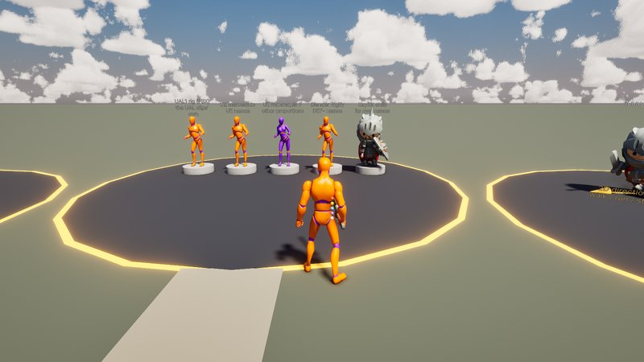
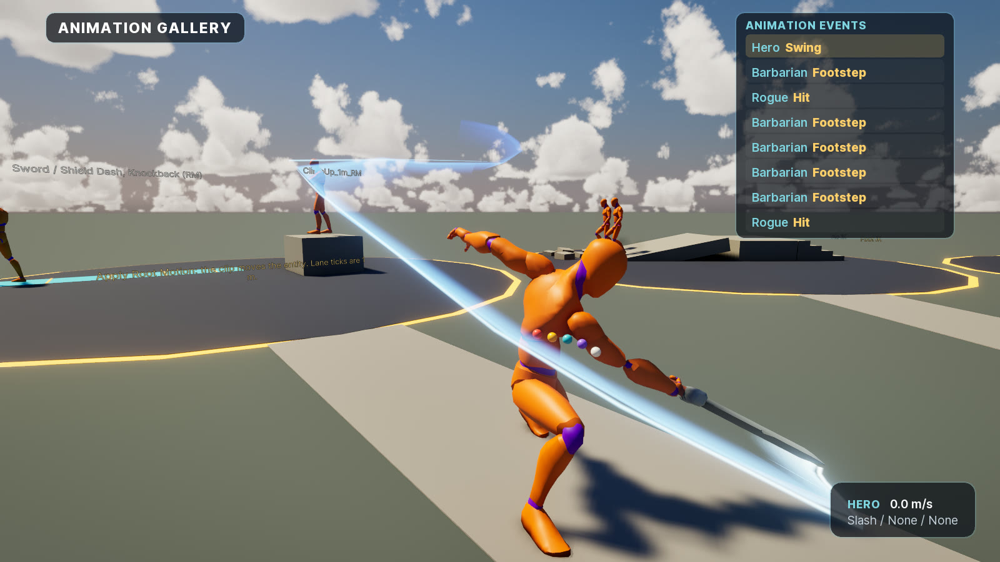
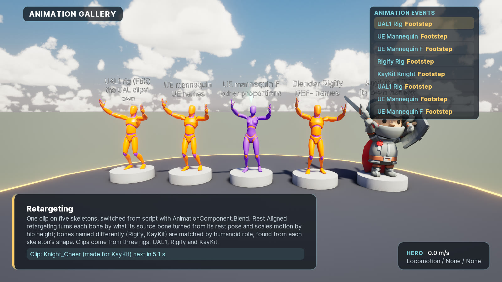
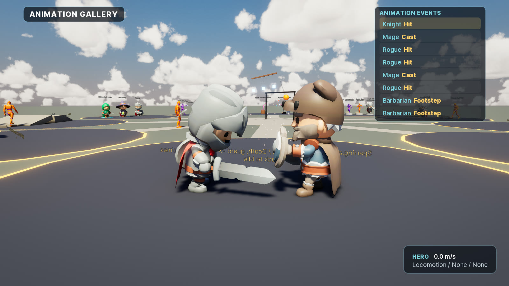
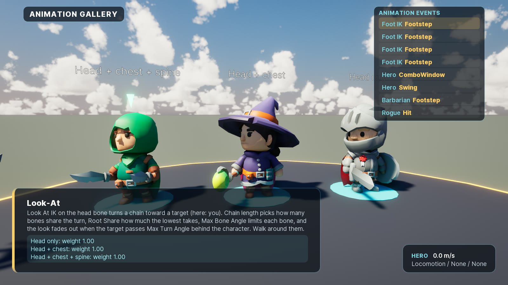
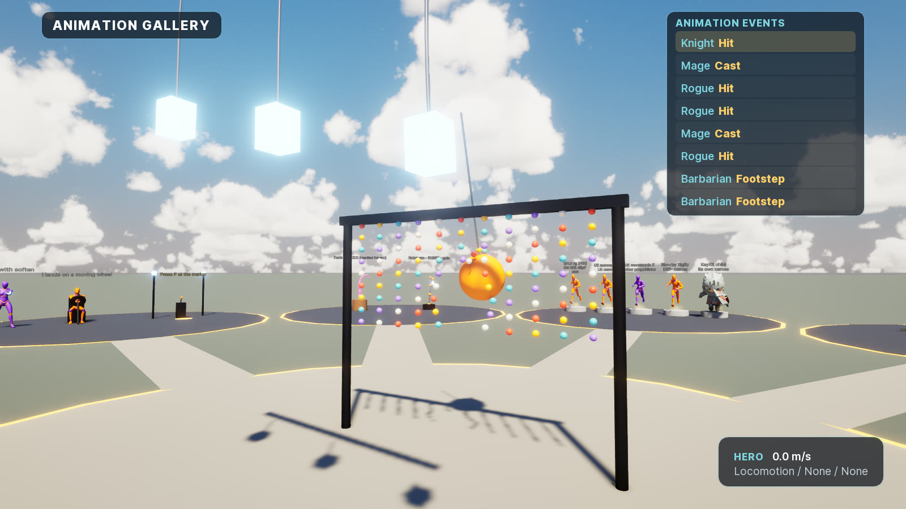
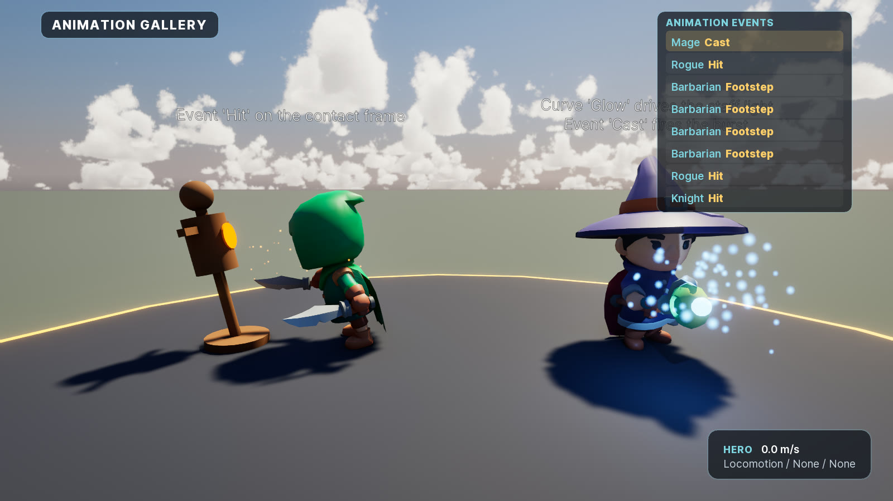

# Animation Gallery

A playable hero walks a plaza of eleven stations, each one a part of the engine's animation system at work: blend
spaces, layers with masks and additive hits, clip events and curves, state machines, root motion, clips retargeted
onto five rigs, foot, hand, chain and look-at IK, and spring bones. A sample project for
[Unravel Engine](https://github.com/unravel-dev/UnravelEngine).

## Play

Clone this repository, or get it from the Samples page of the Unravel editor's start page, and open its folder in
the editor. Open `data/Scenes/Gallery.spfb` and press Play; it is also the startup scene of a deployed build.

| Action | Keyboard and mouse | Gamepad | Touch |
|---|---|---|---|
| Move (relative to the camera) | W A S D / arrows | Left stick | Stick on the left |
| Sprint, walk | Hold Left Shift, hold Left Ctrl | - | - |
| Look around, zoom | Mouse, wheel | - | Drag on the free screen |
| Jump | Space | South (A) | Jump |
| Roll | Q | East (B) | Roll |
| Dash | E | North (Y) | Dash |
| Sword attack, a four-strike combo when repeated | Left click | West (X) | Attack |
| Aim the crossbow, shoot, reload | Hold right click, left click shoots, R reloads | - | - |
| Crouch, dance | C, G | - | - |
| Hit reaction | H | - | - |
| Pull the lever at its marker | F | Right shoulder | Use |
| Show the controls | F1 | - | - |
| Free the cursor | Esc, a left click takes it back | - | - |

A touch screen gets the engine's on-screen controls (`SampleTouchJoystick`); the controls card hides and the event
feed shortens.

## What it shows

### The hero

`HeroController.cs` drives `Animation/Controllers/Hero.actrl` on the mannequin, with root motion applied. Its four
layers: a 2D locomotion blend on speed and crouch with jump, roll, a slash and a three-part combo, pick-up, dance and
dash; a masked upper-body layer that blends aim by pitch, shoot and reload; additive hit reactions; and a sword-arm
carry pose above a jog. The hero also has foot IK, look-at IK aimed at the nearest station character, left-hand two
bone IK weighted by the clip's `HandIK` curve, a sword trail driven by the `Trail` curve, footstep dust and sounds
(`FootstepEffects.cs`), and a spring-bone charm. Jumps leave the ground on the clip's Takeoff event.

### The stations

Each station has a card in the HUD with its title, a description and a live status (`Station.cs`).

- **Retargeting** (`RetargetStation.cs`): five rigs (an FBX mannequin, two glTF mannequins, a Rigify rig and a KayKit
  knight) play nine clips made for three source rigs, blending to the next every six seconds.
- **Blend Spaces** (`BlendSpaceStation.cs`): a runner on a 1D blend by speed and a knight on a 2D strafe blend, with
  a direction arrow.
- **Layers, Masks and Additive** (`LayerStation.cs`): a barbarian walks while a masked upper-body layer cycles cheer,
  block, cast and interact, and additive hits play on top.
- **Events and Curves** (`EventsStation.cs`, `SpellCaster.cs`, `DummyAttacker.cs`, `TrainingDummy.cs`): the mage's
  `Glow` curve drives the staff light and the orb's emission and its `Cast` event fires a burst and a sound; the
  rogue's `Hit` event throws sparks, plays a sound and rocks the dummy.
- **State Machines** (`DuelStation.cs`, `Duelist.cs`): a knight and a barbarian spar under AI, with triggers, Block and
  Dead bools, Any State transitions, tags, a knockout and a get-up.
- **Root Motion** (`RootMotionStation.cs`, `RootMotionActor.cs`): one character climbs a 1 m box, another plays a sword
  dash, a shield dash and a knockback.
- **Foot IK** (`FootIkStation.cs`, `PathWalker.cs`): two walkers cross steps, a slope and stones, one with foot IK and
  one without.
- **Look-At** (`LookAtStation.cs`): a knight, a mage and a rogue follow you with look chains of one, two and three
  bones.
- **Hand IK** (`HandIkStation.cs`, `Orbiter.cs`, `LeverStation.cs`): a driver's hands on a turning wheel, a reacher
  following an orb, and the lever: its Grab event throws it and switches two lamps.
- **Chain IK** (`ChainIkStation.cs`): a five-bone FABRIK robot arm with a pole chases a drone, and an eight-bone CCD
  tentacle reaches for the hero.
- **Spring Bones** (`SpringStation.cs`, `Pendulum.cs`): eleven bead strands collide with a swinging ball, and three
  lanterns hang from a swinging beam.

`GalleryHud.cs` and `EventLog.cs` show the station cards and a feed of the animation events played near the hero.

### Crowd benchmark

`data/Scenes/CrowdBenchmark.spfb` fills the plaza with mannequins on the hero's full controller, from 100 up to 1600:
Up and Down double or halve the crowd, Right and Left add or remove 25, I turns the IK rigs on or off, F1 shows the
help. Its HUD names the editor's Profiler scopes to watch.

## Screenshots

| | |
|---|---|
|  |  |
|  |  |
|  |  |

## Project layout

| Path | What it holds |
|---|---|
| `data/Scenes/` | `Gallery` and `CrowdBenchmark`. |
| `data/Scripts/` | The hero (`HeroController`, `ThirdPersonCamera`, `FootstepEffects`), one script per station (`*Station.cs` and their helpers), the HUD (`GalleryHud`, `EventLog`) and the benchmark (`CrowdBenchmark`). |
| `data/Animation/Controllers/` | The animation controllers: the hero's, the stations' and the benchmark's. |
| `data/Characters/` | The KayKit characters and the mannequin rigs with their clips. |
| `data/Prefabs/CrowdCharacter.pfb` | The benchmark's character. |
| `data/Props/` | The sword and the crossbow. |
| `data/Materials/`, `data/Audio/`, `data/Textures/Particles/` | Materials, sounds and particle sprites. |
| `data/UI/` | `Hud` (the gallery) and `CrowdHud` (the benchmark). |

## Platforms

| Profile | Notes |
|---|---|
| Desktop | Windows or Linux, as the editor runs on. |
| Android | Landscape, with lighter settings: no global illumination, screen-space reflections, ambient occlusion or soft and contact shadows, and half-resolution particles. |

Deploy from the editor's Deploy window with a profile from `profiles/`.

## Credits

| Asset | Author | License | Source |
|---|---|---|---|
| KayKit Character Pack: Adventurers (Knight, Barbarian, Mage, Rogue Hooded, sword, crossbow) | Kay Lousberg | CC0 1.0 | https://kaylousberg.itch.io |
| Mannequins and animations: Universal Animation Library and Universal Animation Library 2 | Quaternius | CC0 1.0 | https://quaternius.com |

The HUD uses the Inter typeface that ships with the engine. Code and all other content are under the MIT license in
[LICENSE](LICENSE).
